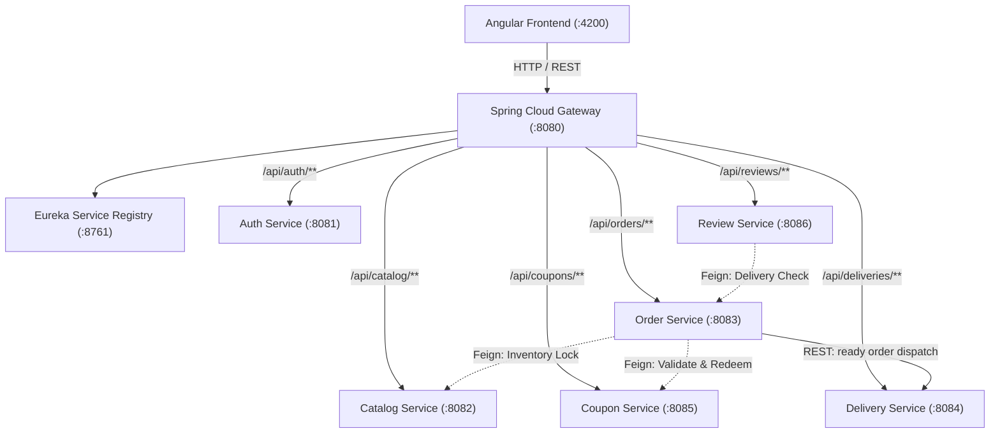

# FoodFlow: Complete System Workflows & API Usage Guide

This document provides a single-source reference for the entire **FoodFlow** microservices ecosystem. It details all operational workflows, inter-service communications, security policies, and complete endpoint usage with request/response payloads.

---

## 1. System Architecture Overview

FoodFlow is built on **Spring Boot 3.3**, **Spring Cloud 2023**, **PostgreSQL**, and an **Angular 17** standalone frontend.



There are no seeded user accounts, menu items, coupons, or simulated login sessions. Public registration creates customer accounts only. Privileged accounts must be provisioned by an authorized operator; never expose role assignment through public registration.

---

## 2. End-to-End System Workflows

### Workflow 1: User Onboarding & Zero-Trust Authentication
1. **Guest Browsing**: A user lands on `http://localhost:4200/`. They view the platform value proposition, 4 pillars showcase, 3-step guide, and public live menu preview.
2. **Access Gate**: If a guest clicks *Add to Cart*, an auth modal prompts them to register or sign in.
3. **Registration**: User fills the registration form (`fullName`, `email`, `password`). The frontend calls `POST /api/auth/register`.
4. **Account Creation**: `auth-service` validates constraints, checks for unique email, hashes the password with BCrypt, and saves a `CUSTOMER` account to `foodflow_auth`. Registration returns account details without a JWT.
5. **Sign In**: The customer signs in through `POST /api/auth/login`. Auth Service issues an **HS256-signed JWT**, which the frontend saves to `sessionStorage`. Authenticated requests carry:
   `Authorization: Bearer <JWT>`
6. **Gateway Authorization**: `api-gateway` executes `JwtGatewayFilter`:
   - Validates the token signature using `${foodflow.jwt.secret}`.
   - Extracts claims (`sub` = userId, `role` = userRole).
   - Removes client-supplied identity headers and injects verified `X-Auth-User-Id` and `X-Auth-User-Role` headers.
   - Downstream services use those headers to establish the request identity and enforce `@PreAuthorize("hasRole('...')")` without re-parsing JWTs. Keep downstream service ports private; only the gateway may be publicly reachable.

---

### Workflow 2: Menu Discovery & Catalog Management
1. **Public Menu Listing**: Guests and customers query `GET /api/catalog/menu?page=0&size=10`. Catalog Service returns active dishes with available stock from `foodflow_catalog`.
2. **Kitchen Dish Creation**: An Admin or Restaurant Owner calls `POST /api/catalog/menu` with dish name, price, description, and available stock.
3. **Real-time Stock Updates**: As orders are placed, the stock count decreases automatically via internal inventory locks.
4. **Catalog provisioning**: Menus start empty and authorized restaurant staff must create actual menu items before customers can order.

---

### Workflow 3: Order Creation, Coupon Redemption & Distributed Inventory Lock
This is a multi-service transactional flow:

```mermaid
sequenceDiagram
    autonumber
    actor Customer as Customer (Frontend)
    participant Gateway as API Gateway (:8080)
    participant Orders as Order Service (:8083)
    participant Coupons as Coupon Service (:8085)
    participant Catalog as Catalog Service (:8082)

    Customer->>Gateway: POST /api/orders (Authorization + Idempotency-Key)
    Gateway->>Orders: Forward with X-Auth-User-Id & X-Auth-User-Role
    Note over Orders: Verify role == 'CUSTOMER' & check Idempotency-Key

    opt If a valid coupon code is provided
        Orders->>Coupons: Feign GET /api/coupons/{code}/validate
        Coupons-->>Orders: Coupon valid (discountPercent = 20%)
        Orders->>Coupons: Feign POST /api/coupons/{code}/redeem
        Coupons-->>Orders: Increments usedCount, returns redeemed coupon
    end

    loop For each item in cart
        Orders->>Catalog: Feign POST /api/catalog/internal/inventory/{id}/reserve
        Note over Catalog: Lock row (PESSIMISTIC_WRITE), decrement availableQuantity
        Catalog-->>Orders: Stock reserved successfully
    end

    Orders->>Orders: Calculate total, reserve inventory, save order (Status: PENDING_PAYMENT)
    Orders-->>Customer: 201 Created (Unpaid Order JSON)
    Customer->>Orders: POST /api/orders/{id}/payment
    Orders->>Razorpay: Create sandbox payment order (server credentials)
    Razorpay-->>Customer: Checkout order ID and public key ID
    Customer->>Razorpay: Complete sandbox checkout
    Razorpay-->>Orders: Checkout signature and payment ID
    Orders->>Razorpay: Verify signature and fetch payment status
    Orders->>Orders: Mark captured payment PAID; order becomes PENDING
```

*Note on Compensation*: If any inventory reserve fails with 409 (insufficient stock) or coupon validation fails, previously reserved items are automatically released via `POST /api/catalog/internal/inventory/{id}/release` and coupon via `POST /api/coupons/{code}/release`.

---

### Workflow 4: Razorpay Sandbox Checkout
1. After an order is created, it remains `PENDING_PAYMENT` and cannot enter kitchen fulfillment.
2. The customer creates a Razorpay sandbox order with `POST /api/orders/{id}/payment`.
3. The frontend opens Razorpay Checkout using the returned public key ID, amount and provider order ID.
4. The customer completes the test transaction using Razorpay's sandbox instruments.
5. The frontend submits the provider response to `POST /api/orders/{id}/payment/verify`.
6. Order Service validates the checkout HMAC signature and independently checks the provider's payment record is captured, correctly ordered, INR-denominated and for the exact server-calculated amount. Only then does it mark the payment paid and order `PENDING`.

Set `RAZORPAY_KEY_ID` and `RAZORPAY_KEY_SECRET` on Order Service from the Razorpay test-mode dashboard. Do not put the secret in frontend code. Without these credentials payment creation fails explicitly; the app never simulates payment success.

---

### Workflow 5: Kitchen Order Management & Status Transitions
1. **Kitchen Queue**: Restaurant Owner opens the Restaurant Portal (`/restaurant`), calling `GET /api/orders/management`.
2. **Accept Order**: Kitchen calls `PATCH /api/orders/{id}/status?value=ACCEPTED`.
3. **Preparation**: Kitchen calls `PATCH /api/orders/{id}/status?value=PREPARING`.
4. **Ready for Pickup**: When food is cooked, kitchen calls `PATCH /api/orders/{id}/status?value=READY_FOR_PICKUP`. Order Service dispatches the order to Delivery Service over REST; repeating this status request safely retries dispatch.

---

### Workflow 6: Delivery Assignment & Fulfillment
1. **Create Available Task**: When the restaurant changes the order to `READY_FOR_PICKUP`, Order Service calls Delivery Service over REST to create an available delivery task.
2. **Driver Queue**: Delivery Partner signs in and opens `/delivery`, which calls `GET /api/deliveries/mine` to show tasks available to claim and tasks already assigned to that partner.
3. **Claim Task**: A partner accepts an available delivery with `POST /api/deliveries/{deliveryId}/claim`. A database row lock ensures only one partner can claim it.
4. **Pickup**: The assigned partner updates status via `PATCH /api/deliveries/{id}/status?status=PICKED_UP`; the order changes to `OUT_FOR_DELIVERY`.
5. **Delivery Complete**: The partner calls `PATCH /api/deliveries/{id}/status?status=DELIVERED`; Order Service rejects completion unless the payment has been provider-verified as captured.

---

### Workflow 7: Customer Ratings & Reviews
1. Customer visits `/orders` after food is delivered.
2. Customer submits review via `POST /api/reviews`.
3. **Review Service** calls Order Service via Feign (`GET /api/orders/{id}`) to verify:
   - The caller is the customer who placed the order.
   - The order status is `DELIVERED`.
   - The order hasn't already been reviewed.
4. Review is saved to `foodflow_review` and displayed on the restaurant's public review list (`GET /api/reviews/restaurant/{restaurantId}`).

---

## 3. Complete API Endpoint Reference & Usages

All requests pass through the unified API Gateway at `http://localhost:8080`.

---

### 3.1 Authentication Service (`/api/auth/**`)

#### 1. Register New Customer
* **Method**: `POST`
* **URL**: `http://localhost:8080/api/auth/register`
* **Access**: `PUBLIC` (No token required)
* **Headers**: `Content-Type: application/json`
* **Request Body**:
```json
{
  "fullName": "Aarav Sharma",
  "email": "aarav@example.com",
  "password": "<choose-a-strong-password>"
}
```
* **Response**: `201 Created` (account details only; no token is issued until login)
```json
{
  "userId": "b476e3d2-4e4b-4b2a-8cb9-9941a329fa5e",
  "fullName": "Aarav Sharma",
  "email": "aarav@example.com",
  "role": "CUSTOMER"
}
```
```json
{
  "token": "eyJhbGciOiJIUzM4NCJ9...",
  "tokenType": "Bearer",
  "userId": "b476e3d2-4e4b-4b2a-8cb9-9941a329fa5e",
  "fullName": "Aarav Sharma",
  "email": "aarav@example.com",
  "role": "CUSTOMER"
}
```
* **cURL Command**:
```bash
curl -X POST http://localhost:8080/api/auth/register \
  -H "Content-Type: application/json" \
  -d '{"fullName":"Customer Name","email":"customer@example.com","password":"<choose-a-strong-password>"}'
```

---

#### 2. Sign In
* **Method**: `POST`
* **URL**: `http://localhost:8080/api/auth/login`
* **Access**: `PUBLIC`
* **Headers**: `Content-Type: application/json`
* **Request Body**:
```json
{
  "email": "customer@example.com",
  "password": "<the-password-you-registered-with>"
}
```
* **Response**: `200 OK`
```json
{
  "token": "eyJhbGciOiJIUzM4NCJ9...",
  "tokenType": "Bearer",
  "userId": "<registered-user-id>",
  "fullName": "Customer Name",
  "email": "customer@example.com",
  "role": "CUSTOMER"
}
```
* **cURL Command**:
```bash
curl -X POST http://localhost:8080/api/auth/login \
  -H "Content-Type: application/json" \
  -d '{"email":"customer@example.com","password":"<the-password-you-registered-with>"}'
```

---

### 3.2 Catalog Service (`/api/catalog/**`)

#### 3. List Available Menu Items (Public)
* **Method**: `GET`
* **URL**: `http://localhost:8080/api/catalog/menu?page=0&size=10`
* **Access**: `PUBLIC`
* **Response**: `200 OK`
```json
{
  "content": [
    {
      "id": "6d584892-1d6f-4f16-b198-255a2e3e581f",
      "restaurantName": "Spice Garden",
      "name": "Paneer Butter Masala",
      "description": "Rich cottage cheese in tomato gravy",
      "price": 280.00,
      "availableQuantity": 22,
      "available": true,
      "version": 1
    }
  ],
  "pageable": { "pageNumber": 0, "pageSize": 10 },
  "totalElements": 1,
  "totalPages": 1,
  "last": true
}
```

---

#### 4. Get Menu Item Details by ID
* **Method**: `GET`
* **URL**: `http://localhost:8080/api/catalog/menu/{id}`
* **Access**: `PUBLIC`
* **Response**: `200 OK`

---

#### 5. Create Menu Item
* **Method**: `POST`
* **URL**: `http://localhost:8080/api/catalog/menu`
* **Access**: `ADMIN`, `RESTAURANT_OWNER`
* **Headers**:
  - `Authorization: Bearer <TOKEN>`
  - `Content-Type: application/json`
* **Request Body**:
```json
{
  "restaurantName": "Spice Garden",
  "name": "Chicken Biryani",
  "description": "Fragrant basmati rice cooked with succulent spiced chicken and saffron",
  "price": 340.00,
  "availableQuantity": 30
}
```
* **Response**: `201 Created`
```json
{
  "id": "8f37b124-749e-4e42-9907-73132e4854f3",
  "restaurantName": "Spice Garden",
  "name": "Chicken Biryani",
  "description": "Fragrant basmati rice cooked with succulent spiced chicken and saffron",
  "price": 340.00,
  "availableQuantity": 30,
  "available": true,
  "version": 0
}
```

---

#### 6. Update Menu Item
* **Method**: `PUT`
* **URL**: `http://localhost:8080/api/catalog/menu/{id}`
* **Access**: `ADMIN`, `RESTAURANT_OWNER`
* **Headers**: `Authorization: Bearer <TOKEN>`
* **Request Body**:
```json
{
  "restaurantName": "Spice Garden",
  "name": "Paneer Butter Masala",
  "description": "Rich cottage cheese in tomato butter gravy, served with cream garnish",
  "price": 290.00,
  "availableQuantity": 25
}
```
* **Response**: `200 OK`

---

#### 7. Delete Menu Item
* **Method**: `DELETE`
* **URL**: `http://localhost:8080/api/catalog/menu/{id}`
* **Access**: `ADMIN`
* **Headers**: `Authorization: Bearer <TOKEN>`
* **Response**: `204 No Content`

---

#### 8. Internal Inventory Reserve (Internal Microservice)
* **Method**: `POST`
* **URL**: `http://localhost:8080/api/catalog/internal/inventory/{id}/reserve`
* **Request Body**: `{"quantity": 2}`
* **Response**: `200 OK` (Decrements `availableQuantity`)

---

#### 9. Internal Inventory Release (Compensation)
* **Method**: `POST`
* **URL**: `http://localhost:8080/api/catalog/internal/inventory/{id}/release`
* **Request Body**: `{"quantity": 2}`
* **Response**: `200 OK` (Increments `availableQuantity`)

---

### 3.3 Coupon Service (`/api/coupons/**`)

#### 10. Validate Coupon Code
* **Method**: `GET`
* **URL**: `http://localhost:8080/api/coupons/{code}/validate`
* **Access**: `Authenticated User` or Internal Feign
* **Headers**: `Authorization: Bearer <TOKEN>`
* **Response**: `200 OK`
```json
{
  "id": "e7208b5f-5309-46be-be32-0402ca9597bb",
  "code": "VALID-COUPON-CODE",
  "discountPercent": 20.00,
  "maxUses": 1000,
  "usedCount": 2,
  "expiresAt": "2027-10-25T13:54:41.802",
  "active": true
}
```

---

#### 11. Redeem Coupon Code
* **Method**: `POST`
* **URL**: `http://localhost:8080/api/coupons/{code}/redeem`
* **Access**: Internal Feign or Authenticated User
* **Response**: `200 OK` (Increments `usedCount`)

---

#### 12. Create New Coupon Code
* **Method**: `POST`
* **URL**: `http://localhost:8080/api/coupons`
* **Access**: `ADMIN`
* **Headers**:
  - `Authorization: Bearer <ADMIN_TOKEN>`
  - `Content-Type: application/json`
* **Request Body**:
```json
{
  "code": "WELCOME50",
  "discountPercent": 50.00,
  "maxUses": 500,
  "expiresAt": "2027-12-31T23:59:59"
}
```
* **Response**: `201 Created`

---

### 3.4 Order Service (`/api/orders/**`)

#### 13. Create & Place Order
* **Method**: `POST`
* **URL**: `http://localhost:8080/api/orders`
* **Access**: `CUSTOMER`
* **Headers**:
  - `Authorization: Bearer <CUSTOMER_TOKEN>`
  - `Idempotency-Key: <UUID>`
  - `Content-Type: application/json`
* **Request Body**:
```json
{
  "items": [
    {
      "menuItemId": "6d584892-1d6f-4f16-b198-255a2e3e581f",
      "quantity": 1
    }
  ],
  "couponCode": "VALID-COUPON-CODE"
}
```
* **Response**: `201 Created`
```json
{
  "id": "de92fda7-0516-4c59-887d-d0ea679edaca",
  "customerId": "a831cd0e-3815-4034-8ac9-a4bbd1bb77f7",
  "status": "PENDING",
  "totalAmount": 224.00,
  "discountAmount": 56.00,
  "couponCode": "VALID-COUPON-CODE",
  "items": [
    {
      "id": "3e9b1102-12a8-48b2-8ea9-a8312019941a",
      "menuItemId": "6d584892-1d6f-4f16-b198-255a2e3e581f",
      "itemName": "Paneer Butter Masala",
      "unitPrice": 280.00,
      "quantity": 1,
      "lineTotal": 280.00
    }
  ],
  "createdAt": "2026-10-25T13:55:32.481Z"
}
```

---

#### 14. Get My Orders (Customer History)
* **Method**: `GET`
* **URL**: `http://localhost:8080/api/orders/mine?page=0&size=10`
* **Access**: `CUSTOMER`
* **Headers**: `Authorization: Bearer <CUSTOMER_TOKEN>`
* **Response**: `200 OK`
```json
{
  "content": [
    {
      "id": "de92fda7-0516-4c59-887d-d0ea679edaca",
      "customerId": "a831cd0e-3815-4034-8ac9-a4bbd1bb77f7",
      "status": "PENDING",
      "totalAmount": 224.00,
      "discountAmount": 56.00,
      "couponCode": "VALID-COUPON-CODE",
      "createdAt": "2026-10-25T13:55:32.481Z"
    }
  ],
  "totalElements": 1,
  "totalPages": 1
}
```

---

#### 15. Kitchen Management Orders Queue
* **Method**: `GET`
* **URL**: `http://localhost:8080/api/orders/management?page=0&size=10`
* **Access**: `ADMIN`, `RESTAURANT_OWNER`
* **Headers**: `Authorization: Bearer <TOKEN>`
* **Response**: `200 OK` (Returns all orders across customers)

---

#### 16. Get Specific Order Details
* **Method**: `GET`
* **URL**: `http://localhost:8080/api/orders/{id}`
* **Access**: Owner Customer, `ADMIN`, or Internal Feign
* **Headers**: `Authorization: Bearer <TOKEN>`
* **Response**: `200 OK`

---

#### 17. Update Order Status
* **Method**: `PATCH`
* **URL**: `http://localhost:8080/api/orders/{id}/status?value=PREPARING`
* **Access**: `ADMIN`, `RESTAURANT_OWNER`, `DELIVERY_PARTNER`
* **Allowed Values**: `ACCEPTED`, `PREPARING`, `READY_FOR_PICKUP`, `PICKED_UP`, `DELIVERED`, `CANCELLED`
* **Headers**: `Authorization: Bearer <TOKEN>`
* **Response**: `200 OK`

---

### 3.5 Delivery Service (`/api/deliveries/**`)

#### 18. Assign Order to Delivery Partner
* **Method**: `POST`
* **URL**: `http://localhost:8080/api/deliveries/{orderId}/assign?partnerId={partnerUUID}`
* **Access**: `ADMIN`, `RESTAURANT_OWNER`
* **Headers**: `Authorization: Bearer <TOKEN>`
* **Response**: `201 Created`
```json
{
  "id": "a901842b-5819-4820-8012-781903e1a8bb",
  "orderId": "de92fda7-0516-4c59-887d-d0ea679edaca",
  "partnerId": "33333333-3333-3333-3333-333333333333",
  "status": "ASSIGNED",
  "createdAt": "2026-10-25T14:10:00Z"
}
```

---

#### 19. Get Available and Assigned Delivery Tasks
* **Method**: `GET`
* **URL**: `http://localhost:8080/api/deliveries/mine`
* **Access**: `DELIVERY_PARTNER`
* **Headers**: `Authorization: Bearer <PARTNER_TOKEN>`
* **Response**: `200 OK` (Available tasks and tasks assigned to the partner)

---

#### 20. Claim an Available Delivery
* **Method**: `POST`
* **URL**: `http://localhost:8080/api/deliveries/{deliveryId}/claim`
* **Access**: `DELIVERY_PARTNER`
* **Headers**: `Authorization: Bearer <login JWT>`
* **Response**: `200 OK` (Task is now assigned to the requesting partner)

---

#### 21. Update Delivery Status (Driver Progress)
* **Method**: `PATCH`
* **URL**: `http://localhost:8080/api/deliveries/{id}/status?status=PICKED_UP`
* **Access**: `DELIVERY_PARTNER`
* **Allowed Statuses**: `PICKED_UP`, `DELIVERED`
* **Headers**: `Authorization: Bearer <PARTNER_TOKEN>`
* **Response**: `200 OK`

---

### 3.6 Review Service (`/api/reviews/**`)

#### 21. Submit Review for Delivered Order
* **Method**: `POST`
* **URL**: `http://localhost:8080/api/reviews`
* **Access**: `CUSTOMER`
* **Headers**:
  - `Authorization: Bearer <CUSTOMER_TOKEN>`
  - `Content-Type: application/json`
* **Request Body**:
```json
{
  "orderId": "de92fda7-0516-4c59-887d-d0ea679edaca",
  "restaurantId": "550e8400-e29b-41d4-a716-446655440000",
  "rating": 5,
  "comment": "Paneer was fresh and hot, delicious curry! Delivered on time."
}
```
* **Validation Rules**:
  - Customer must be the owner of the order.
  - Order status must be `DELIVERED` (verified via Feign call to Order Service).
  - Can only submit one review per order (unique constraint).
* **Response**: `201 Created`
```json
{
  "id": "c1928410-1823-4e4b-9912-109284716294",
  "orderId": "de92fda7-0516-4c59-887d-d0ea679edaca",
  "customerId": "a831cd0e-3815-4034-8ac9-a4bbd1bb77f7",
  "restaurantId": "550e8400-e29b-41d4-a716-446655440000",
  "rating": 5,
  "comment": "Paneer was fresh and hot, delicious curry! Delivered on time.",
  "createdAt": "2026-10-25T14:30:00Z"
}
```

---

#### 22. Get Restaurant Reviews (Public)
* **Method**: `GET`
* **URL**: `http://localhost:8080/api/reviews/restaurant/{restaurantId}?page=0&size=10`
* **Access**: `PUBLIC`
* **Response**: `200 OK` (Paginated list of reviews)

---

## 4. Error Responses & Status Codes

All microservices adhere to standard RFC 7807 / `ApiError` format:

```json
{
  "timestamp": "2026-10-25T13:55:00.000Z",
  "status": 401,
  "error": "Unauthorized",
  "message": "Full authentication is required to access this resource",
  "path": "/api/orders"
}
```

### Standard Status Codes
| Status | Meaning | Occurrence |
|---|---|---|
| `200 OK` | Request Succeeded | Retrieval, login, status updates |
| `201 Created` | Resource Created | Registration, order created, review submitted |
| `204 No Content` | Deleted Successfully | Menu item deleted |
| `400 Bad Request` | Validation Error | Missing fields, password too short |
| `401 Unauthorized` | Missing / Invalid Token | No Bearer header or expired JWT |
| `403 Forbidden` | Insufficient Role Privileges | Customer trying to access Admin endpoints |
| `404 Not Found` | Resource Not Found | Coupon or item ID doesn't exist |
| `409 Conflict` | Domain Constraint Conflict | Email already registered, insufficient inventory, order not delivered |

---

## 5. Quick Verification Script (Copy & Paste)

You can run this snippet in Node.js or browser console to test the entire lifecycle from login to checkout:

```javascript
async function testFoodFlowLifecycle() {
  const BASE = 'http://localhost:8080';

  // 1. Authenticate as Customer
  const authRes = await fetch(`${BASE}/api/auth/login`, {
    method: 'POST',
    headers: { 'Content-Type': 'application/json' },
    body: JSON.stringify({ email: 'customer@example.com', password: '<the-password-you-registered-with>' })
  });
  const auth = await authRes.json();
  const token = auth.token;
  console.log('✅ 1. Authenticated as:', auth.fullName);

  // 2. Fetch Live Menu
  const menuRes = await fetch(`${BASE}/api/catalog/menu`);
  const menu = await menuRes.json();
  const item = menu.content[0];
  console.log('✅ 2. Found Dish:', item.name, 'Price: ₹' + item.price);

  // 3. Validate Promo Code
  const couponRes = await fetch(`${BASE}/api/coupons/VALID-COUPON-CODE/validate`, {
    headers: { 'Authorization': `Bearer ${token}` }
  });
  const coupon = await couponRes.json();
  console.log('✅ 3. Validated Coupon:', coupon.code, 'Discount:', coupon.discountPercent + '%');

  // 4. Place Order with Feign inventory reservation
  const orderRes = await fetch(`${BASE}/api/orders`, {
    method: 'POST',
    headers: {
      'Content-Type': 'application/json',
      'Authorization': `Bearer ${token}`,
      'Idempotency-Key': 'key-' + Date.now()
    },
    body: JSON.stringify({
      items: [{ menuItemId: item.id, quantity: 1 }],
      couponCode: 'VALID-COUPON-CODE'
    })
  });
  const order = await orderRes.json();
  console.log('✅ 4. Order Created! ID:', order.id, 'Total: ₹' + order.totalAmount, 'Status:', order.status);

  // 5. Query Customer Order History
  const historyRes = await fetch(`${BASE}/api/orders/mine`, {
    headers: { 'Authorization': `Bearer ${token}` }
  });
  const history = await historyRes.json();
  console.log('✅ 5. Verified in History. Total Orders:', history.totalElements);
}

testFoodFlowLifecycle();
```
