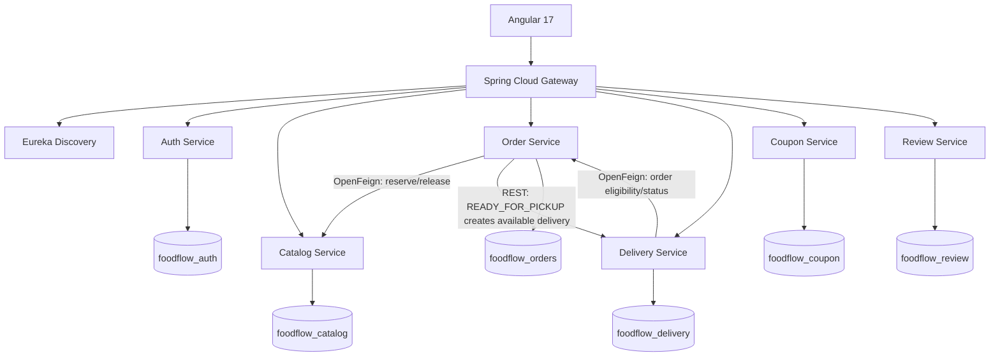

# FoodFlow architecture

## Business invariants
- Catalog Service owns inventory and serializes reservations using a PostgreSQL pessimistic write lock.
- Order Service owns order status and immutable item price snapshots.
- Delivery Service owns assignment records; only the assigned partner may update them.
- Coupon Service owns coupon definitions and usage counts.
- Review Service prevents more than one review per customer/order using a database unique constraint.
- Delivery tasks become available to delivery partners when an order reaches `READY_FOR_PICKUP`.
- A stock reservation plus order write spans services; compensation is best-effort. A production-grade version should persist outbox/reconciliation records for failed compensation.
